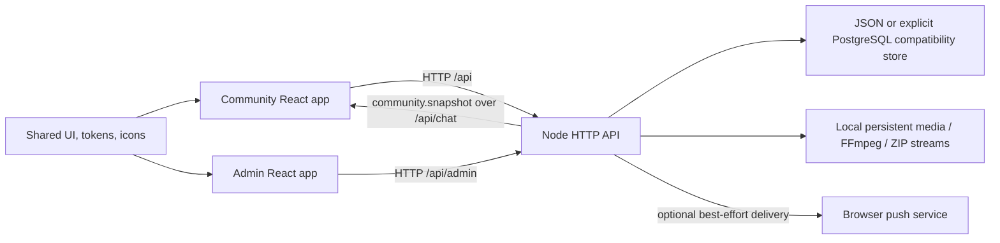

# Architecture and state ownership

[Handbook](README.md) / Architecture

## Repository map

| Location | Responsibility |
| --- | --- |
| [apps/web/src/app](../../apps/web/src/app) | Community composition, navigation and window/player wiring |
| [apps/web/src/hooks](../../apps/web/src/hooks) | Community, realtime, playback, layout and persistence adapters |
| [apps/web/src/components](../../apps/web/src/components) | App-specific pack/editor/player, sharing and PWA composition |
| [apps/web/src/features](../../apps/web/src/features) | Feature logic, including interactive onboarding |
| [apps/web/src/services](../../apps/web/src/services) | Upload/download/pack HTTP helpers and external-link utilities |
| [apps/api/src](../../apps/api/src) | Framework-free HTTP API, media, storage and realtime |
| [apps/admin/src](../../apps/admin/src) | Independently built administration console |
| [packages/ui/src](../../packages/ui/src) | Shared types, foundations, components, templates and Workspace |
| [packages/tokens/src](../../packages/tokens/src) | CSS/TypeScript/JSON design roles |
| [packages/icons/src](../../packages/icons/src) | Shared SVG React icons |
| [scripts](../../scripts) | Development orchestration and guide recording/publishing |

## Runtime flow

Development uses Vite proxies. Production uses one Node process serving the built
web/admin assets and guides alongside `/api`; there is no separate browser-to-DB
connection. See [API/data](api-and-data.md) and [operations](operations.md).

## Layering

Shared domain types, formatting and low-level helpers sit below composite UI.
The normal direction is foundations/types/utilities -> atoms -> molecules ->
organisms -> templates -> app composition. Shared UI must not import app runtime
implementation. Some UI-hosted integration tests intentionally import web code.

`Workspace` is the composition tier managing independent window contexts; it is
not a page template or a floating workspace-shell window. The app supplies
services, actual content and one playback engine to reusable UI.

## State owners

| State | Owner and persistence |
| --- | --- |
| Accounts, releases, pack membership/grants, friends/messages, downloads, A-List decisions | API; JSON or opted-in PostgreSQL |
| Authorized community snapshot | `useCommunity`; refreshed over HTTP and realtime, not an authorization source |
| Actual audio and queue contexts | `useAudioPlayback`; one audio engine, independent window context positions/settings |
| Running/inspected workspace, groups, windows, saved checkpoints | Shared `Workspace` plus window registry; app adapter saves validated account snapshots |
| Pack/upload/editor form drafts | Mounted UI session; workspace layouts do not serialize browser Files or full form contents |
| Main player placement and theme | Browser preferences; not the same as account workspace sync |
| Tutorial completion/dismissal | API account record, independently for desktop/mobile |
| Current tutorial step/action checklist | In-session guide state; partial-step server resume is a proposed follow-up |

[`useWindowWorkspace`](../../apps/web/src/hooks/useWindowWorkspace.ts) debounces
layout snapshots and serializes saves with the owner ID. API validation guards
cross-account delayed requests. Sync is last-write-wins recovery on loading, not
live collaborative layout or draft synchronization.

## Safe extension points

- A new media surface must carry media kind and distribution independently through
  types, filters, cards, pack queues and server checks.
- New window content needs stable IDs, grouping/close behavior and correct
  session-only versus restorable persistence.
- New commands must preserve commit-before-side-effect ordering in PostgreSQL
  mode, while retaining JSON behavior.
- New tutorial actions should report successful typed activity at the actual
  operation boundary, not infer completion from a button click.
- New design states belong in shared semantic tokens/foundations, not page-local
  literal colors. See [frontend guidance](frontend.md).
